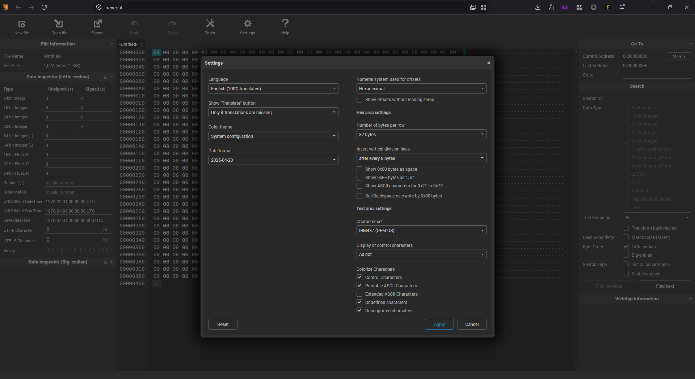
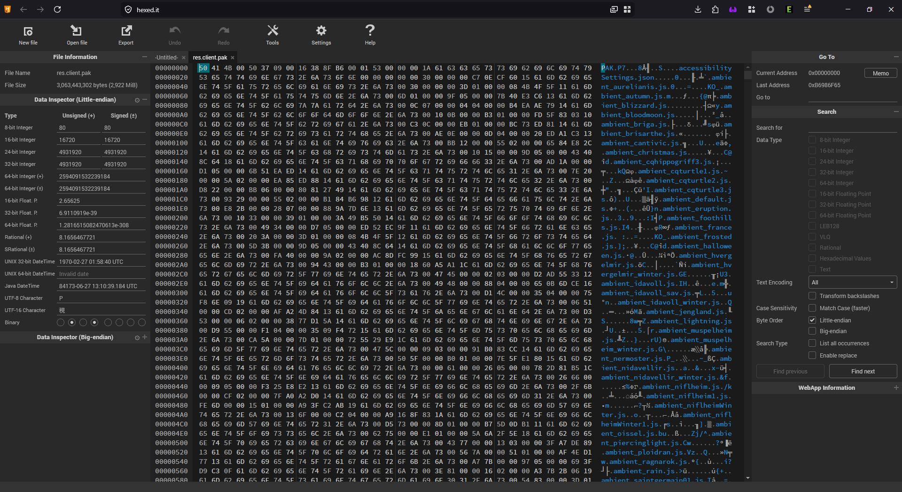
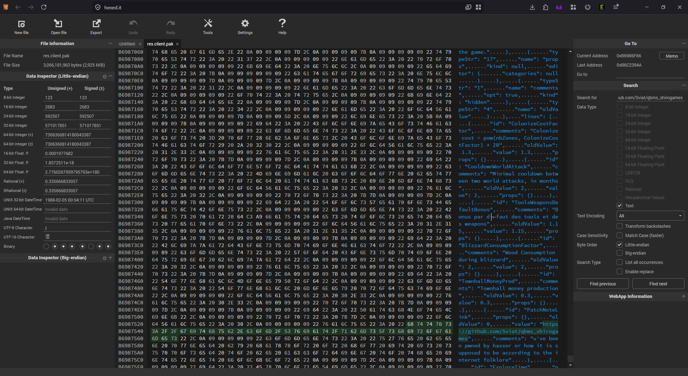
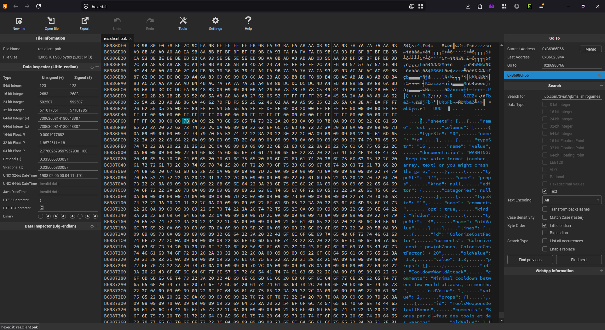
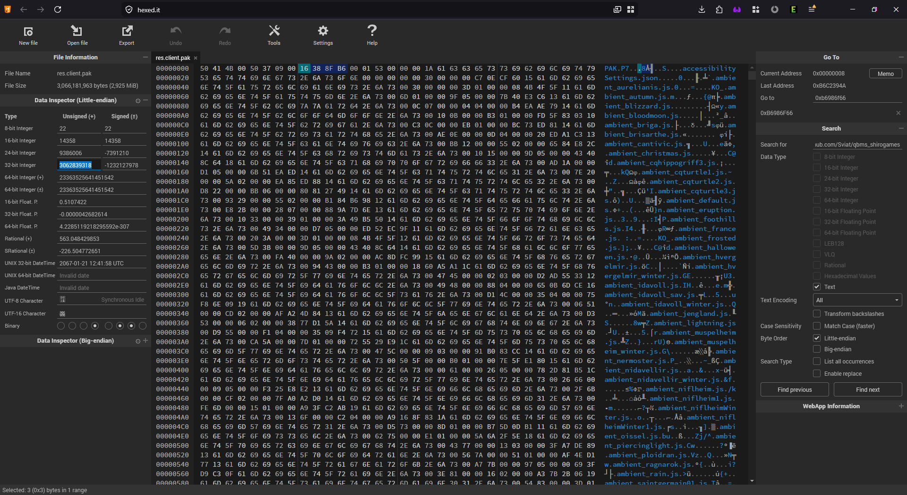
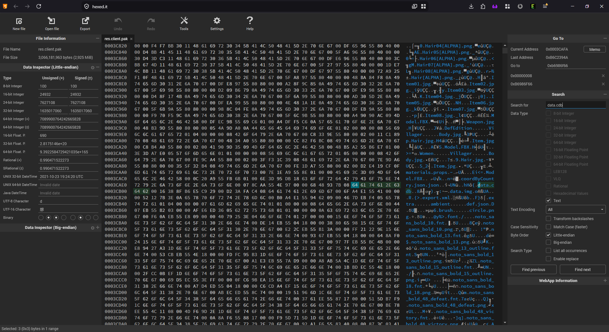
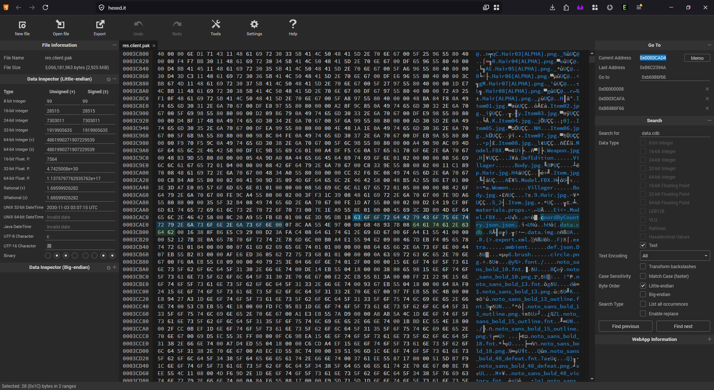
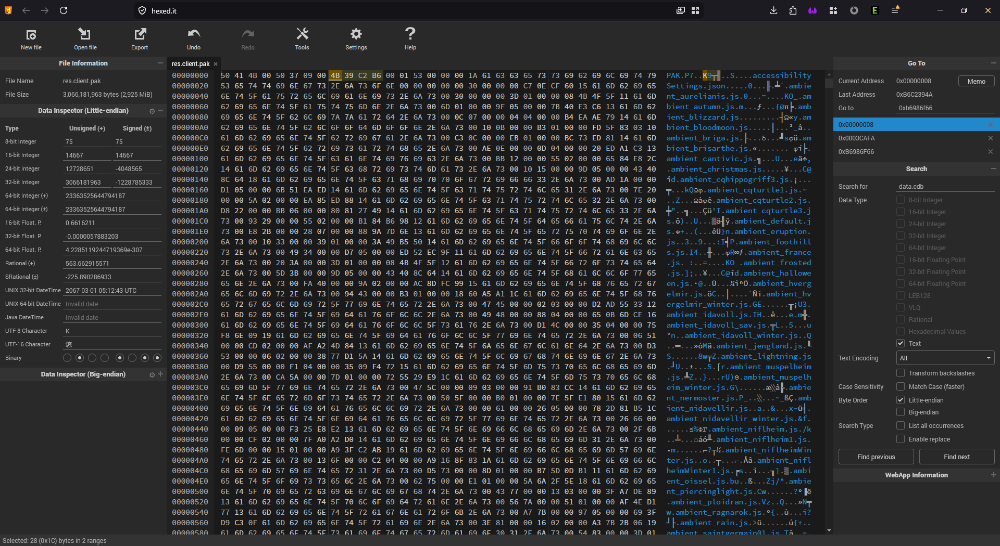
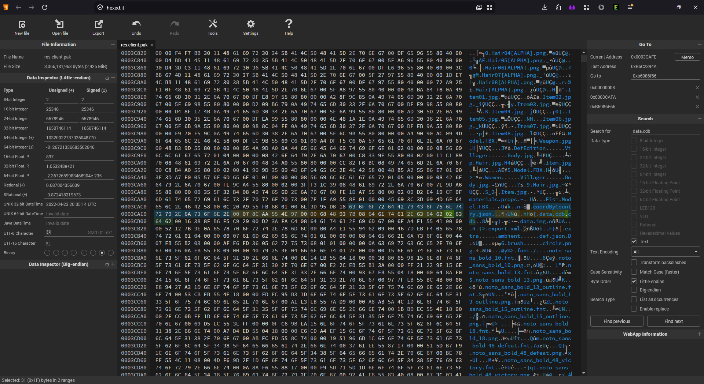
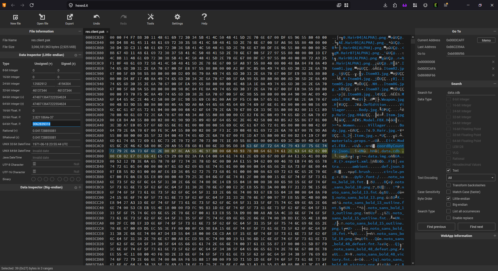

# The Northgard Hex

This guide will teach you how vivisect Northgard ~~for fun and proffit~~ for shit and giggles.

## Introduction
This guide was supposed to be created very long time ago, but after I saw people abusing different, much smaller, holes in Northgard system in Ranked MP, I decided to keep it under radars until Shiro fixes as many of them as possible. Since then many things changed, most importantly Northgard balance, which completely killed competetive scene and made it only interesting for casual gaming. So I quickly lost focus and forgot about NG for a while, until recently I saw an [expanded guide by Peter Quinn](https://docs.google.com/document/d/11-JgsN1Nc_uUWAbK2zDpYk7ueUx7JwFdo61EsE6hHmY/edit?tab=t.0#heading=h.1r4o1fwmc59z).

Looks like Northgard is **both** technologically ready **and** dead for competetive scene so it is time (imagine here meme of cat staring at the wall clock).

## Prerequisites

Usually this goes [to the chapter below](#motivation), but I will need all these fancy terms and abbreviations there, so lets define them earlier:
- 5-10 GB's of disk space, SSD preferably
- Get [Northgard](https://store.steampowered.com/app/466560/Northgard_Definitive_Edition/) game files, especially ``res.client.pak`` which holds majority of game files. For short I'll call it `ResPak` from now on.
- Get any Text Editor [VS Code](https://code.visualstudio.com/)
- Get any Hex Editor (yes, we going that deep), preferably something free and using browser so you dont need to even download it, like [HexEdit](https://hexed.it/)
- Get [QuickBMS](https://aluigi.altervista.org/quickbms.htm) tool a.k.a `QBMS`
- Couple of hours without distraction (hardest to obtain)

## Motivation

Although there are plenty of things to hack with (images/sprites, audio, etc), we will focus on the most important thing - database, also known as `CDB` (due filename of ``data.cdb``). This is HEAPS's database, but serialized/stored as plain JSON, so it is both 1) easily editable using ordinary text editor of choice, like VS Code, and 2) human-readable. That makes it most desired target for manipulations. One only need to unpack `ResPak`, change text in `CDB` and pack it back to have all sorts of fun with game mechanics and content. However...

...since Northgard's `ResPak` eventually got belly fat and overstepped psychological limit of 2GBs, it has to be packed by Shiro using two different techniques (you can get familiar with this in `The Guide`). So simple `QBMS`'s script which was replacing database **inline** couldnt handle this anymore and fail horribly **iff** your changes to `CDB` were introducing new bytes (may be reducing them too, but I didnt check).

So there were all kind of second-order-hacks, that were replacing only integer values with values of same magnitude (i.e, 10->42), or swapping abilities positions. But nothing could add anything new, more than original had.

If only there was a way, to fully replace `CDB` with our own, modified one, without having to deal with `ResPak`'s format issues...

## Methods

### Logistics

After prerequisites fulfilled, we need to
- (Optionally) read `The Guide` from same auther on [how to use QuickBMS with Northgard](../README.md)
- Copy any `ResPak` (i.e, latest from Steam directory) into some safe backup space on your fastest drive. We will need it all. Using live `ResPak` directly from Steam is possible YET HIGHLY UNADVICEABLE
- Unpack copied `ResPak` using `QBMS` and `The Guide` instructions into directory, i.e `extracted`
- Obtain any modified `CDB` file you can quickly verify in game, we will call it `CDBest`
- (Optionally) take one from `extracted` and modify around line ~70:
    - Search for:
        ```json
				{
					"id": "PatchNoteLink",
					"props": {},
					"oldValue": 0,
					"value": "https://store.steampowered.com/news/app/466560/view/2887361327909342868"
				},
        ```
    - Replace with:
        ```json
				{
					"id": "PatchNoteLink",
					"props": {},
					"oldValue": 0,
					"value": "https://github.com/Sviat/qbms_shirogames",
					"comments": "u've been pwned by haxxor or how it is supposed to be according to the internet folklore"
				},
        ```
    - This makes `CDBest` absolutely unusable for dumb re-import procedure (unless you changed replacing value with yours thinking you know better)
- Pack this back to a new `ResPak`, we will call it `ResPakest`, why not
    - Open directory with your `QBMS` and preferably copied `ResPak` from before
    - Put the `CDBest` file into it `repak` directory
    - Run `QBMS` like pro: ```quickbms\quickbms_4gb_files.exe -w -r -r -o -D Northgard\northgard.bms Northgard\res.client.pak Northgard\repak```
    - Nota Bene: THIS WILL MODIFY `ResPak` YOU REFER TO!
    - Remember its output, you may need it one day:
        ```
        offset           filesize   filename
        --------------------------------------
        < 00000000b6986f66 2738661    data.cdb
        ```

### Reconnaissance
In this chapter we verify correctness of our procedures and assumptions, but don't touch anything.


Open HexEditor and tune it a little bit for yourself. Surprisingly, the one from `HexEd.it` is almost perfect as it is. But make sure you have as much of a screen space as you can for main data view; dont show unnecessary symbols in `Byte` area and colorize `ASCII Preview` area a bit for readability.


Now open your `ResPakest` prepared [a step above](#logistics) in HexEditor.


Search for the text, you know is in this `ResPakest` (in our case it is ``https://github.com/Sviat/qbms_shirogames``), to verify packing worked and we have it in the file. If all correct, you should find it down below closer to the end of your scroll bar. We are not interested in its position, rather where `CDBest` was placed to.


If you still remember the output from `QBMS` (``b6986f66`` a.k.a. ``0xB6986F66``) it is there, otherwise just scroll a little bit up from there, until you find an open curly bracket of JSON file - `{`. In your case it may be anything else, important part is cross-check the `QBMS` output with real address through HexEditor. Remember this address, i.e, using `Memo` (not Meme, it is important) button - `MEMO: CDBest Data Address`. Now we ready to work.

### Surveillance
In this chapter we identify, mark and trace targets for analysis.

Most experienced of you already read `The Guide` and checked `BMS` scripts attached, so you know the Shiro's PAK file format. For the rest I'll remind that it a binary file with three main sections, called
1) meta data,
2) file index and
3) raw data storage

where first two (meta data + file index) usually collectively called header.


Meta data is super strict (precisely to the byte) and to not bore to death everyone reading, for us it includes format marker a.k.a. ID [0; 4] (``PAK`` in this exact case), raw data offset [5; 8]  and filesize in bytes [9; 12].
1. Select the 5th byte from beginning and write somewhere it's value as `MEMO: Header Size Value` (Address is always: 0x00000004, value ``50 37 09 00`` or 603984 on provided screenshot). This size is effectively an Offset to the beginning of Raw Data section.
2. Select the 9th byte from beginning and Memo it's address in HexEdit as `MEMO: Raw Data Size Value` (Address is always: 0x00000008, value on screenshot (just for your info): ``16 38 8F B6`` or 3062839318).
3. Lets remember for future, that their sum **SHOULD BE** equal to the total `ResPak` size, you can see it in top-left corner on screenshot. However `QBMS` already appended (3062839318 + 603984 = 3063443302 != 3066181963).


File index is a list of records, that contain its (file or folder) name, type, size and offset. These are the links for where and data stored. For us it is important to find original `CDB` file record, which is (sadly) located in the middle of the file index, due to file-tree traversal method (lexicographical depth-first). Memo this address too as `MEMO: CDB Index Address` (Address will vary, but roughly around 0x0003CAFA).

Raw data storage starts exactly after header and spans till the end of file. It contains (no surprise) raw data of all files in the PAK. It may be binary (in case textures, sounds etc) or text (in case of `CDB`). For us important only our `CDBest` that was well-placed by `QBMS` in the end of the file. We already marked its address before so nothing to do for now.

One thing to note before we proceed, is the record format in file index differs not only between files and folders, but also between those files in data storage that fit into first 2GB of file and all the rest. Without deeper technical mumbo-jumbo we need to know that those before 2GB mark (lets call it "first half"), are 4 bytes shorter than those that are after (lets call it "second half", even though they are not halves and not even equal).

Observing `CDB` record in index we can make conclusion, that it is located in the first half. Now you need to take into account position of `CDBest` - if it is in the second half (and it will most likely be) - that means there is no easy way to "just" change record and point it to newer file. One way would be changing `CDB` record, expanding it and then shifting all records and data after it by 4 bytes further. Or just packing from a scratch using custom repacker, as some members of community doing. This is not our way, because we hate easy ways. Now lets do some anylysis.

### Intelligence
In this chapter we analyze all acquired pieces of information before starting processing and exploitation.

1. `CDB` record links to `CDB` raw data located in "first half" of the `ResPak` (and our `ResPakest` respectively)
2. `CDB` record begins with ``data.cdb`` plain text (actually, one byte earlier, but this is not important right now), and spans right until next record, which begins with ``data.img`` (same one byte earlier). Inside it encoded offset to raw data (in 4 bytes)
3. `CDBest` raw data is located in "second half" of the `ResPakest`. Offset to this location will require 8 bytes in our index
4. To route `CDB` record from old file to new, we need to convert record type from one type (`type 0` for nerds), to another type (`type 2` for nerds); then update offset from old (first half) to new (second half) location; then update database file size from old to new (gladly in this case we need as many bytes as before)
5. This cannot be done in-place, because `type 0` records are 4 bytes shorter than `type 2` records
6. To make this work we need to either:
    - Shift all records and data after `CDB` record by 4 bytes further
    - or borrow 4 bytes from some donor just before `CDB` record


Let's inspect file index closely paying more attention to the record right before `CDB`. It looks like poor ``coordByCountry.json.json`` file ended up there. It is no surprise, knowing order of sorting and traversal. What is most important for us, it is absolutely useless for game session and we can safely cut piece of it's binary meat for the needs of growing `CDB`.

There probably is better or less damaging way, but I find it super ironic, that file which has UNNECESSARY BUT USED double extension will donate it to the file that now has all NECESSARY BUT UNUSED data. My salute to whoever named it like this. Without that, I would feel completely bad doing what we about to do.

One last note on offset calculation. Inside each record, offset is referring to the offset since **the beginning of raw data section**. So if we want to point to the file raw data, we need to add header size to it. But we dont want to, because we already know this address precisely! What we need is exactly the inverse. We need to take `MEMO: CDBest Data Address` and deduct `MEMO: Header Size Value` from it (if you not sure how to substract numbers, use `Calculator` in `Programmer mode`), to get offset for the file index record. Save this as `MEMO: CDBest Record Offset Value`.

This was the last piece of intelligence we needed to start processing `ResPakest` file, lets start.

### Processing
In this chapter we will go through all identified targets and change them to our needs. Unlike all previous, it will be void of narrative and kept as TL;DR as possible.

1. Go to the `MEMO: Raw Data Size Value` bookmark
    1. Calculate new RawData size, by taking total file size minus `MEMO: Header Size Value`
    2. Put computed value in `32-bit Integer` field to the one you get from your file explorer (in my case it was from ``3062839318`` to ``3066181963``)
    3. Nota bene: values on screenshots and values in this document sometimes may differ as it takes multiple iterations to get proper `ResPak`
    

2. Go to the `MEMO: CDB Index Address` bookmark. Move cursor to the left until you reach last ``json`` of ``coordByCountry.json.json`` file name bytes.

    1. Starting from ``6A`` byte (letter `j`) just retype what you see 4-bytes to the right of current position, until and including ``data.cdb`` (i.e, ``6A`` <- ``00``, ``73`` <- ``07``, ``6F`` <- ``8C``, ``6E`` <- ``AA``...etc).
    
    2. Remember, as it was pointing to the first half of raw data, it has record `type 0` so after last letter you copied next byte is ``00``. Dont copy it, instead write there (after ``62``) the ``02`` byte.
    3. Next 4 bytes will be leftover copy of `.cdb` text, that will be overwritten by new offset. Put your cursor on the first byte of it (``2E``) and type `MEMO: CDBest Record Offset Value` in `64-bit Float. P.` field.
    
    4. In general, you may need to update file size value from old (2738583 in my case) to new (2738661) in the same address space. But usually, `QBMS` is doing this for you, so just verify valid values.

### Exploiting
That was it, there is no chapter. Processing is done, now enjoy Exploitation phase.

Download/save resulting `ResPakest` file from HexEditor and put it to the Northgard directory. Start the game and you will see you changes. Unless it crashes. Then you did something wrong. But thats the whole fun of the process, enjoy debugging! You didn't make backup of original ``res.client.pak``, didnt you?

## Summary and conclusions
If you followed this guide precisely and now running Northgard only to see it crashing on start, welcome into the current moment, where such blunt changes are no longer working.

This whole guide was written long time ago as a memo to self; recently I just reproduced steps and reshot images to publish it. Now it is only useful as an artifact of specific time.

## Acknowledgements
I am grateful to `Pringle`, no not to every pringles around there, but to very specific one, who motivated initial research in this direction. Sadly it didnt work as expected, but nowadays I hope easier way of modding (cascading `res.clientX.pak`s) will help him on his way.

As usual, thanks to all Northgard modding community, especially `NG Editoroom`, to `Northgard RUS` and `Northgard Wiki` discord servers for being there. And Shiro games, but there were no needs to kill competetive scene just to say development is over. We got it.